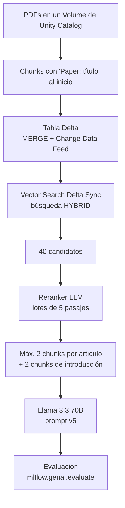

# rag-papers-databricks

RAG sobre artículos científicos en Databricks (Free Edition): búsqueda híbrida en Vector Search, reranker con LLM,
generación con Llama 3.3 70B y evaluación con `mlflow.genai.evaluate`.

## Arquitectura



La configuración que se midió se llama **"v6"**: prompt v5 + reranker que ve el título del paper + máximo 2 chunks por
artículo + 2 chunks de introducción (`_0` y `_1`) del artículo principal. Es lo que devuelve `make_rag()` por defecto.
"v6" no es un prompt (ver `rag_lab/prompts.py`).

## Resultados

Set final: 44 preguntas del dominio + 10 fuera de tema (`eval/cases.json`), evaluadas en 3 corridas de v6
(12-13 de noviembre de 2026, endpoint gratuito, 1 worker). **Correctness 0.909, estable en las 3 corridas**; 0.95-0.975 en
preguntas específicas.

| Corrida | correctness | relevance_to_query | retrieval_groundedness | retrieval_relevance | ood_correctness |
|---|---|---|---|---|---|
| v6-r1 | 0.909 | 1.000 | 0.977 | 0.407 | 1.0 |
| v6-r2 | 0.909 | 1.000 | 1.000 | 0.407 | 1.0 |
| v6-r3 | 0.909 | 1.000 | 0.977 | 0.416 | 1.0 |

Correctness por tipo de pregunta (3 ambiguas, 40 específicas, 1 global, 10 fuera de tema):

| Tipo | v6-r1 | v6-r2 | v6-r3 |
|---|---|---|---|
| específica | 0.950 | 0.950 | 0.975 |
| ambigua | 0.333 | 0.333 | 0.000 |
| global | 1.000 | 1.000 | 1.000 |
| fuera de tema | 1.000 | 1.000 | 1.000 |

Latencia del RAG por pregunta, en segundos:

| Corrida | p50 | p95 | max |
|---|---|---|---|
| v6-r1 | 11.0 | 17.1 | 23.2 |
| v6-r2 | 12.4 | 23.0 | 29.4 |
| v6-r3 | 17.3 | 38.2 | 44.1 |

Las 3 corridas tardaron 45 min 56 s en total. El detalle de cada experimento, incluida la variante barata de 2 llamadas
al reranker, está en [`docs/experimentos.md`](docs/experimentos.md).

## Limitaciones

- **Preguntas ambiguas** (varios papers responden): correctness de 0 a 0.33. El sistema no resuelve bien estos casos.
- **Latencia**: p50 de 11 a 17 s y p95 de 17 a 38 s, con 8 llamadas al reranker por pregunta (40 candidatos en lotes de 5).
  La variante de 2 llamadas (20 candidatos en lotes de 10) baja el p50 a ~9 s, pero pierde 7-9 puntos de correctness.
- **Los prompts v2 a v5 se afinaron sobre las 23 preguntas originales** (0.957 de correctness ahí). Las 21 preguntas
  nuevas funcionan como set más independiente, y por eso el número honesto es 0.909.
- **`retrieval_relevance` ~0.41**: el juez cuenta los chunks de introducción como no relevantes.
- **Corpus pequeño y jueces LLM**: 12 papers, 1112 chunks. Con 44 preguntas, cada una mueve la correctness 0.023.

## Decisiones de diseño

- **Título en cada chunk** (`Paper: <título>`): el retriever, el reranker y el LLM saben de qué artículo es cada pasaje.
- **MERGE en vez de overwrite** al escribir la tabla: los chunks que desaparecen se borran también del índice y solo se
  re-embeben los que cambian.
- **Reranker con LLM en lotes pequeños** (5 pasajes por llamada): lotes pequeños dan mejor juicio, a costa de más llamadas.
- **Diversidad por artículo**: máximo 2 chunks por artículo entre los 4 que llegan al LLM.
- **Chunks de introducción**: se añaden los chunks `_0` y `_1` (título/abstract) del artículo del primer resultado.
- **Evaluación separada** dentro y fuera del dominio, con `verify_cases` previo para comprobar que las respuestas
  esperadas existen de verdad en los chunks.

## Cómo reproducir

Requisitos: workspace de Databricks con Unity Catalog, Vector Search y endpoints de Foundation Models (el notebook
original se probó en Databricks Free Edition).

1. Clona el repo como Git folder en el workspace.
2. Crea el endpoint de Vector Search en la UI (por defecto `genai_lab_vs`). No se crea por código.
3. Sube los PDFs al Volume (enlaces en [`data/README.md`](data/README.md)).
4. Ejecuta los notebooks en orden: `notebooks/01_ingesta.py`, `02_demo.py` y `03_evaluacion.py`.

Los valores por defecto se pueden sobreescribir con variables de entorno:

| Variable | Valor por defecto |
|---|---|
| `RAG_CATALOG` | `test` |
| `RAG_SCHEMA` | `genai_lab` |
| `RAG_VOLUME` | `raw_docs` |
| `RAG_VS_ENDPOINT` | `genai_lab_vs` |
| `RAG_EMBEDDING_MODEL` | `databricks-qwen3-embedding-0-6b` |
| `RAG_LLM_ENDPOINT` | `databricks-meta-llama-3-3-70b-instruct` |

**Validación del repo (16 de noviembre de 2026):** los notebooks 01 a 03 se ejecutaron de punta a punta en Databricks
Free Edition. Una corrida de `03_evaluacion` dio correctness 0.909, relevance_to_query 1.000, retrieval_groundedness
0.977, retrieval_relevance 0.428 y 1.000 fuera de tema, igual que el notebook original. La re-ingesta produjo 1111 chunks
(1112 en el notebook original), probablemente por versiones distintas de las librerías de PDF y chunking.

## Trabajo futuro

- **Preguntas ambiguas** (varios papers responden): hoy dan 0 a 0.33 de correctness. Es la mayor debilidad del sistema.
- **Latencia del reranker**: 8 llamadas al LLM por pregunta. La variante de 2 llamadas es más rápida pero pierde
  correctness; falta una opción intermedia que conserve la calidad.
- **Set de evaluación más grande**: con 44 preguntas, cada una mueve la correctness 0.023.
- **Dependencias deprecadas**: migrar `databricks-vectorsearch` a `databricks-ai-search` y `get_open_ai_client()` a
  `databricks-openai`, y volver a validar con `03_evaluacion`.

## Estructura del repo

```
rag_lab/        config, clients, utils, ingest, index, retrieval, prompts, generation, evaluation
eval/           cases.json (44 casos del dominio + 10 fuera de tema)
notebooks/      01_ingesta, 02_demo, 03_evaluacion, 04_generar_casos
docs/           experimentos.md
data/           README.md (lista de los 12 papers; los PDFs no se incluyen)
tests/          test_utils, test_prompts, test_cases (corren sin Databricks)
```

## Tests

```
pip install -r requirements-dev.txt && python -m pytest
```

Los tests no necesitan Databricks, mlflow ni pyspark.

## Más información

Historia de los experimentos v2 a v6: [`docs/experimentos.md`](docs/experimentos.md).
